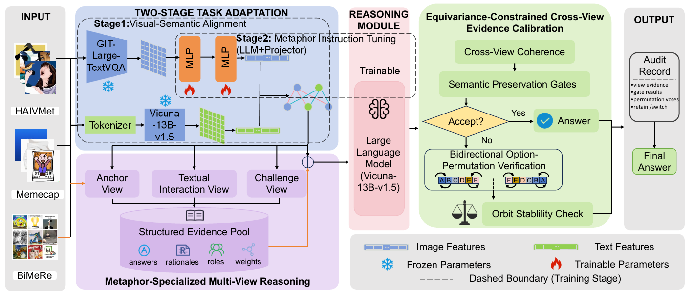

<div align="center">

# MERCURY

### Metaphor Evidence Reasoning with Cross-View Consistency and Equivariance-Constrained Calibration

**Xiaojian Lou · Qimeng Yang† · Hui Song**<br>
Xinjiang University, Urumqi, China<br>
† Corresponding author: [Qimeng Yang](mailto:yangqm@xju.edu.cn)

**ACM Multimedia Asia 2026 (MMAsia '26)**<br>
December 15–18, 2026 · Hanoi, Vietnam

[](docs/MERCURY-MMAsia2026.pdf)
[](docs/MERCURY-MMAsia2026.pdf)
[](#overview)

[Paper](docs/MERCURY-MMAsia2026.pdf) · [Method](#method) · [Results](#results) · [Getting Started](#getting-started) · [Citation](#citation)

</div>

## Overview

MERCURY studies how multimodal large language models can connect concrete visual cues with abstract, non-literal meanings. It combines task adaptation, metaphor-specialized multi-view reasoning, and conservative evidence calibration to improve the reliability of metaphor interpretation.

The paper introduces **BiMeRe**, a Chinese–English benchmark of **6,068** metaphorical samples. Each sample asks a model to select the correct interpretation from six closely related candidates, with human-verified answers and reasoning annotations. MERCURY achieves **70.87% English accuracy** and **72.07% Chinese accuracy** in the paper's evaluation against 18 representative open- and closed-source MLLMs.

## Method

<div align="center">
  
  <p><em>Framework overview from Figure 3 of the camera-ready paper.</em></p>
</div>

1. **Two-stage task adaptation.** Visual-semantic alignment trains the cross-modal projector on HAIVMet and MemeCap; metaphor-reasoning instruction tuning then adapts the projector and language model on BiMeRe. The paper uses GIT-Large-TextVQA and Vicuna-13B-v1.5.
2. **Metaphor-Specialized Multi-View Reasoning (MS-MVR).** Anchor, Textual Interaction, and Challenge roles gather complementary evidence about the global metaphor, image–text interaction, and misleading literal interpretations. Weighted evidence produces the initial prediction.
3. **Equivariance-Constrained Cross-View Evidence Calibration (EC-CVEC).** Cross-view consistency and semantic preservation constrain answer revision. Unresolved disagreement is checked with forward and backward option permutations, with predictions mapped back to their original candidate identities.

In this repository, `infer_mercury.py` implements multi-view inference. The `cvec` and `pesc` stages of `evidence_calibration.py` expose the cross-view and permutation-verification components of EC-CVEC. These command names are implementation entry points for the paper's two main modules, MS-MVR and EC-CVEC.

## Results

The following are **paper-reported results**, not measurements newly produced by this repository update. Accuracy is reported in percent; Table 1 uses the None / zero-shot prompting setting.

### Selected main results

| Model | English | Chinese |
|:--|--:|--:|
| Qwen2.5-VL-72B | 63.32 | 66.57 |
| GPT-4o | 62.04 | 59.60 |
| Qwen-VL-Max | 62.73 | 66.92 |
| GLM-4V-Plus | 64.53 | 65.09 |
| Claude-3.7-Sonnet | 66.20 | 65.24 |
| **MERCURY** | **70.87** | **72.07** |

The paper also reports a comparison with matched evaluation sample IDs: Claude-3.7-Sonnet obtains **67.30%** on English and InternVL-2.5-8B obtains **69.66%** on Chinese. MERCURY exceeds these scores by **3.57** and **2.41 percentage points**, respectively. See Section 5.1 for the evaluation context and the complete comparison.

### Ablation study

| Setting | English | Chinese |
|:--|--:|--:|
| **MERCURY** | **70.87** | **72.07** |
| Without EC-CVEC | 64.57 | 65.86 |
| Without MS-MVR | 60.31 | 57.24 |
| Without both modules (vanilla fine-tuning) | 55.59 | 55.00 |

Source: Table 2 of the camera-ready paper. The experiments use language-specific 6:2:2 train/validation/test splits; the reported test sets contain **635 English** and **580 Chinese** samples.

## BiMeRe and Available Resources

| Resource | Paper benchmark | Current repository |
|:--|:--|:--|
| English annotations | 3,172 samples | `data/E_metaphors_cot.json` |
| Chinese annotations | 2,896 samples | `data/C_metaphors_cot.json` |
| Task | Six-choice metaphor interpretation | Questions, options, answers, rationales, and metadata |
| Images | Images associated with the benchmark | 444 English and 100 Chinese images are bundled |
| Evaluation splits | Separate train/validation/test sets | The paper's split files are not bundled |
| Model checkpoints | Task-adapted GIT / Vicuna backbone | Checkpoints are not bundled |

**Reproduction requirements.** The bundled images cover only part of the annotation files. Full reproduction requires the complete matching images, the paper's train/validation/test splits, and the task-adapted checkpoint with its compatible model runtime. The loader skips records whose images are missing, so the default bundled-data run must not be interpreted as a full-benchmark evaluation. This repository does not currently provide a checkpoint download link.

BiMeRe builds on metaphorical images from MET-Meme, CII-Bench, II-Bench, and DEEPEVAL. Please consult the original resources for their terms of use and attribution requirements.

## Getting Started

### Environment

Use a Linux environment with NVIDIA CUDA support and Bash. The dependency list pins PyTorch 2.4.1 and Transformers 4.46.3 and includes CUDA-oriented packages such as FlashAttention, Triton, and DeepSpeed.

```bash
git clone https://github.com/constant-lou/MERCURY.git
cd MERCURY
python -m venv .venv
source .venv/bin/activate
python -m pip install -r requirements.txt
```

### Model checkpoint

Place the task-adapted checkpoint in `checkpoints/mercury` and configure the model adapter:

```bash
export MERCURY_MODEL_PATH="$(pwd)/checkpoints/mercury"
export PYTHONPATH="$(pwd)/src/infer/models:$(pwd)/src/infer:$(pwd)/src:${PYTHONPATH:-}"
```

The checkpoint must match the visual encoder and language-model architecture used for training. If a custom model implementation is required, make it importable through `PYTHONPATH`. Optional settings include `MERCURY_MODEL_BASE` and `MERCURY_CONV_MODE`. The supported adapter name is `git-llava-13b`.

### Data layout

```text
data/
  E_metaphors_cot.json
  C_metaphors_cot.json
images/
  Eimages/
  Cimages/
```

Image paths in annotation records are resolved relative to `images/`. The loader supports JSON and JSONL, including split filenames ending in `_cot`. To evaluate a supplied paper split, place its file in `data/` and pass the split name without its extension.

### Complete inference and evaluation pipeline

After configuring the checkpoint and data:

```bash
bash run_mercury.sh
```

The runner executes multi-view inference, cross-view calibration, permutation verification, and overall/subgroup evaluation. Defaults are `E_metaphors C_metaphors`, mode `none`, batch size 1, and one worker. Supported modes are `none`, `cot`, `domain`, and `emotion`.

For a small pipeline check using available images:

```bash
SPLIT_LIST="E_metaphors C_metaphors" \
MODE_LIST="none" INFER_LIMIT=10 bash run_mercury.sh
```

The sample limit is for checking execution, not for reproducing the paper's test-set results. Outputs are organized as follows:

```text
results/
  multi_view/    # MS-MVR predictions and view evidence
  cvec/          # Cross-view calibration outputs
  pesc/          # Final permutation-verification outputs
  evaluation/    # Overall accuracy and subgroup summaries
```

### Individual stages

```bash
python src/infer/infer_mercury.py \
  --config src/config/config_mercury.yaml \
  --split E_metaphors --mode none \
  --model_name git-llava-13b --output_dir results/multi_view

python src/infer/evidence_calibration.py \
  --stage cvec --config src/config/config_mercury.yaml \
  --split E_metaphors --mode none \
  --baseline_result_dir results/multi_view --output_dir results/cvec

python src/infer/evidence_calibration.py \
  --stage pesc --config src/config/config_mercury.yaml \
  --split E_metaphors --mode none \
  --baseline_result_dir results/multi_view --output_dir results/pesc

python src/eval_mercury.py \
  --evaluate_all --output_dir results/pesc --save_dir results/evaluation/pesc

python src/eval_mercury_sub.py \
  --input_dir results/evaluation/pesc \
  --save_to results/evaluation/pesc/mercury_results_table.txt
```

Both calibration commands read the MS-MVR evidence pool. The `pesc` stage performs its cross-view check internally before running any necessary permutation probes. `training/` contains training code and scripts; reproducing training also requires the corresponding input datasets and model initialization.

## Repository Structure

```text
MERCURY/
  assets/                 # Framework illustration and supplementary figures
  docs/                   # Camera-ready paper
  data/                   # Bilingual annotations
  images/                 # Bundled image subset
  src/
    config/               # Configuration and prompts
    infer/                # MS-MVR, calibration, data loading, and model adapter
    eval_mercury.py        # Overall evaluation
    eval_mercury_sub.py    # Subgroup evaluation
    validate_result_coverage.py
  tests/                  # Pipeline and repository checks
  training/               # Training implementation and scripts
  CITATION.cff            # Machine-readable citation
  run_mercury.sh          # Inference and evaluation runner
```

## Citation

If you use MERCURY or BiMeRe in your research, please cite:

```bibtex
@inproceedings{lou2026mercury,
  title     = {{MERCURY}: Metaphor Evidence Reasoning with Cross-View Consistency and Equivariance-Constrained Calibration},
  author    = {Lou, Xiaojian and Yang, Qimeng and Song, Hui},
  booktitle = {ACM Multimedia Asia (MMAsia '26)},
  year      = {2026},
  publisher = {Association for Computing Machinery},
  address   = {New York, NY, USA},
  location  = {Hanoi, Vietnam},
  url       = {https://github.com/constant-lou/MERCURY}
}
```

## Acknowledgments and Contact

MERCURY builds on GIT, Vicuna, LLaVA, and the source datasets described in the paper. Please retain the original notices and follow the terms applicable to each dependency, checkpoint, and dataset.

For questions about the code, use [GitHub Issues](https://github.com/constant-lou/MERCURY/issues). For research correspondence, contact [Qimeng Yang](mailto:yangqm@xju.edu.cn).
